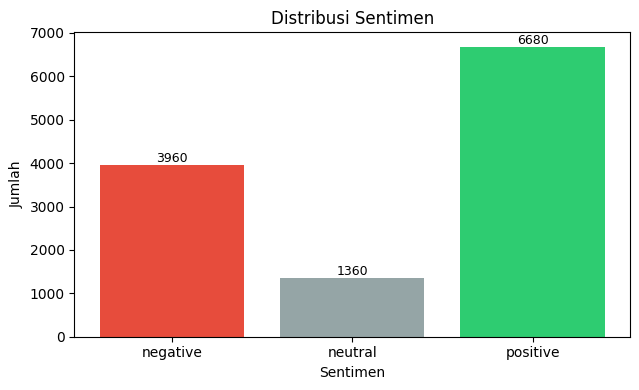
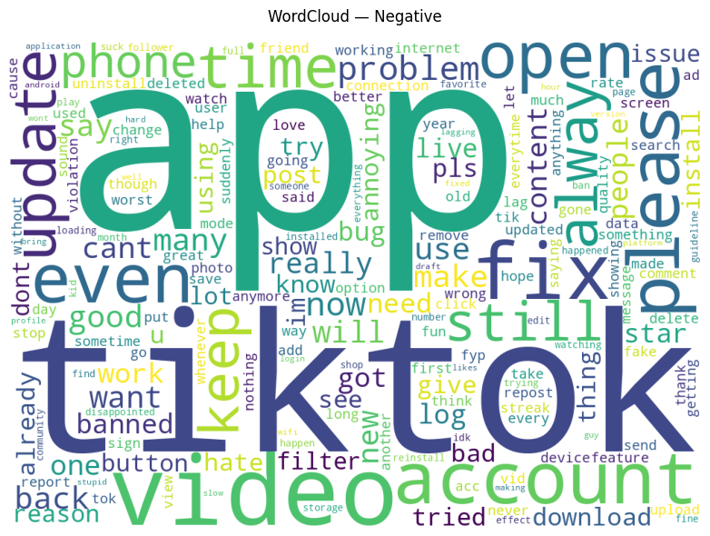
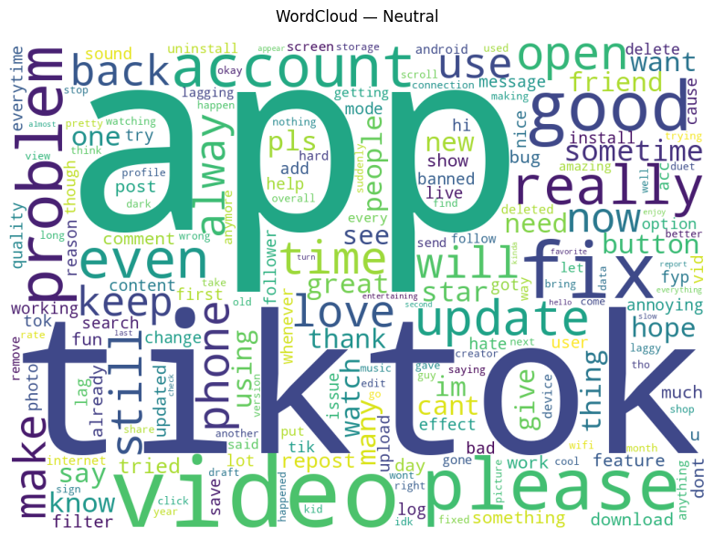
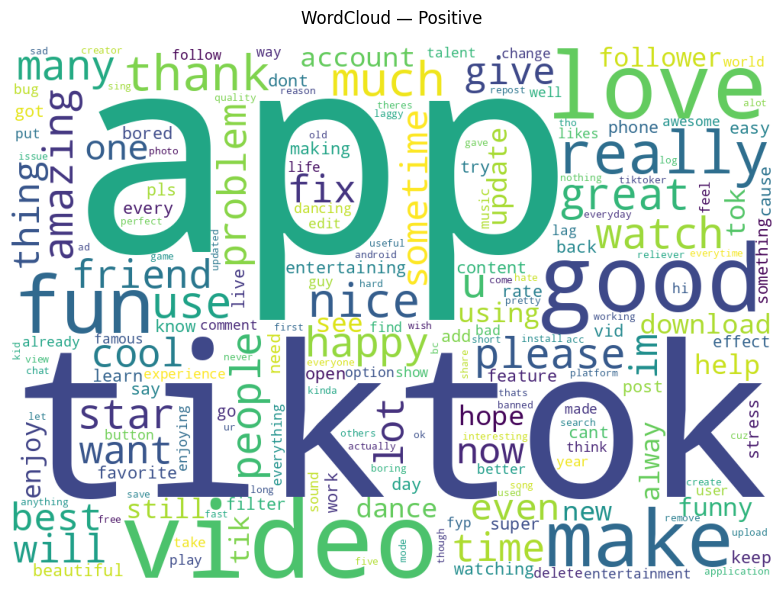
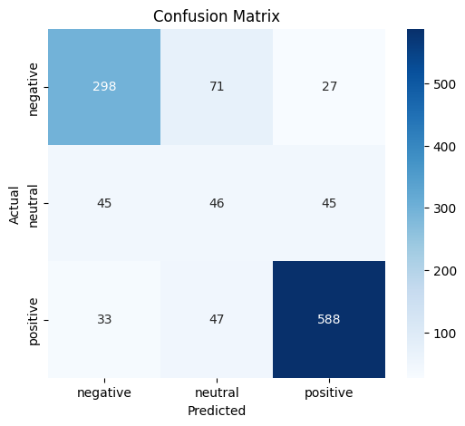

# TikTok App Review Sentiment Analysis Using BERT

## 🎯 Project Overview

This project focuses on analyzing user reviews of the TikTok application on Google Play Store using the **BERT (Bidirectional Encoder Representations from Transformers)** model.

The main objective is to classify user reviews into three sentiment categories: **Positive, Negative, and Neutral**. This analysis aims to understand user opinions, identify common feedback patterns, and evaluate the performance of BERT in classifying application reviews.

The project uses the `bert-base-uncased` pretrained model to perform multiclass sentiment classification.

## 📁 Dataset Information

The dataset was collected from Google Play Store reviews of the TikTok application.

**Dataset Details:**
- **Dataset Name:** `scrapped_TikTok_EN.csv`
- **Total Records:** 72,000 reviews
- **Total Columns:** 11
- **Data Format:** CSV
- **Language:** English
- **Data Type:** Raw Dataset

### Dataset Columns

| Column | Description |
|---|---|
| `reviewId` | Unique review identifier |
| `userName` | Name of the reviewer |
| `userImage` | Reviewer's profile image |
| `content` | Review text |
| `score` | Rating given by the user (1–5) |
| `thumbsUpCount` | Number of likes received |
| `reviewCreatedVersion` | Application version when the review was created |
| `at` | Review submission date |
| `replyContent` | Developer response |
| `repliedAt` | Date of developer response |
| `appVersion` | Application version |

### Sentiment Labeling

The sentiment labels are determined based on the rating score:

| Rating | Sentiment |
|---|---|
| 1–2 | Negative |
| 3 | Neutral |
| 4–5 | Positive |

The model experiment uses 12,000 sampled reviews from the original dataset.

## 🛠️ Tools & Technologies

- **Programming Language:** Python
- **Environment:** Google Colab / Jupyter Notebook
- **Data Processing:** Pandas, NumPy
- **Data Visualization:** Matplotlib, Seaborn, WordCloud
- **Natural Language Processing:** NLTK
- **Deep Learning Framework:** PyTorch
- **Pretrained Model:** BERT (`bert-base-uncased`)
- **Transformer Library:** Hugging Face Transformers
- **Model Evaluation:** Scikit-learn

## 🔄 Project Workflow

The project follows these main stages:

1. **Data Collection** – Collecting TikTok application reviews from Google Play Store.
2. **Data Understanding** – Exploring dataset structure, columns, missing values, and review ratings.
3. **Data Preprocessing** – Preparing review text for sentiment classification.
4. **Sentiment Labeling** – Assigning Positive, Negative, and Neutral labels based on user ratings.
5. **Data Splitting** – Dividing the dataset into training, validation, and testing sets using an 80:10:10 ratio.
6. **Model Development** – Fine-tuning the pretrained BERT model with class weighting to address class imbalance.
7. **Model Evaluation** – Evaluating model performance using accuracy, precision, recall, F1-score, and confusion matrix.

## 📊 Key Analysis Areas

The analysis focuses on several important aspects:

- **Sentiment Distribution:** Identifying the distribution of positive, negative, and neutral reviews.
- **Word Frequency:** Exploring frequently occurring words in user reviews.
- **Sentiment Classification:** Classifying reviews using the BERT model.
- **Class Imbalance:** Examining differences in the number of reviews across sentiment categories.
- **Model Performance:** Evaluating classification performance using multiple evaluation metrics.

## 🔍 Key Findings

The BERT model achieved an overall accuracy of **77.67%** on the test dataset.

### Model Evaluation Results

| Metric | Score |
|---|---:|
| Accuracy | 77.67% |
| Macro F1-Score | 0.65 |
| Weighted F1-Score | 0.78 |

### Classification Report

| Sentiment | Precision | Recall | F1-Score | Support |
|---|---:|---:|---:|---:|
| Negative | 0.78 | 0.76 | 0.77 | 396 |
| Neutral | 0.33 | 0.29 | 0.31 | 136 |
| Positive | 0.88 | 0.90 | 0.89 | 668 |
| **Macro Average** | **0.66** | **0.65** | **0.65** | **1,200** |
| **Weighted Average** | **0.78** | **0.78** | **0.78** | **1,200** |

The model performs better in identifying positive and negative reviews, while neutral sentiment remains more challenging to classify.

## ⚠️ Data Quality Findings

Several data quality conditions were identified during dataset exploration:

- The original dataset contains 72,000 review records.
- The dataset consists of 11 columns.
- The `replyContent`, `repliedAt`, `reviewCreatedVersion`, and `appVersion` columns contain missing values.
- No duplicate rows were identified across all columns.
- The `content` and `score` columns are the primary fields used for sentiment analysis.

Missing values in metadata columns do not necessarily affect the classification process because the main analysis uses review text and rating scores.

## 📈 Model Evaluation Visualizations

The following visualizations present the results of the sentiment analysis and model evaluation.

### 1. Sentiment Distribution



### 2. Word Cloud





### 3. Confusion Matrix



### 4. Classification Report


### 5. Sentiment Prediction Example


## 💡 Insights & Recommendations

Based on the sentiment analysis results, several insights and recommendations can be identified:

- **Positive Reviews:** Positive sentiment represents the largest group in the evaluated test dataset, indicating generally favorable user feedback.
- **Negative Reviews:** Negative reviews can provide useful information about user complaints, application issues, and areas requiring improvement.
- **Neutral Reviews:** Neutral sentiment has the lowest classification performance, suggesting that further improvements in data representation and model training may be necessary.
- **Application Improvement:** TikTok developers can use sentiment analysis results to identify recurring user concerns and prioritize improvements to application features and user experience.
- **Future Development:** Further experiments with different preprocessing techniques, larger datasets, and alternative model configurations may improve classification performance.

## 📝 Conclusion

This project demonstrates the application of BERT for multiclass sentiment analysis of TikTok reviews collected from Google Play Store.

Using the `bert-base-uncased` pretrained model, the classification system achieved an accuracy of 77.67% across three sentiment categories: Positive, Negative, and Neutral.

The results show that BERT can effectively classify positive and negative reviews, although neutral sentiment remains more challenging.

The analysis can serve as a foundation for understanding user feedback and supporting data-driven application improvement.

## 🗂️ Project Structure

```text
TikTok-Sentiment-Analysis-BERT/
│
├── dataset/
│   └── scrapped_TikTok_EN.csv
│
├── notebooks/
│   └── PI_Nasywa_Dina_Natania_51422209.ipynb
│
├── results/
│   ├── sentiment_distribution.png
│   ├── wordcloud.png
│   ├── confusion_matrix.png
│   ├── classification_report.png
│   └── prediction_example.png
│
├── requirements.txt
├── .gitignore
└── README.md
```

## 📌 Project Status

**Status:** Completed

The project includes data exploration, preprocessing, sentiment labeling, BERT model development, model evaluation, visualization, and sentiment prediction for new review text.

## 👩‍💻 Author

**Nasywa Dina Natania**

GitHub: [@nasywadina](https://github.com/nasywadina)

LinkedIn: [Nasywa Dina Natania](https://www.linkedin.com/in/nasywadina/)